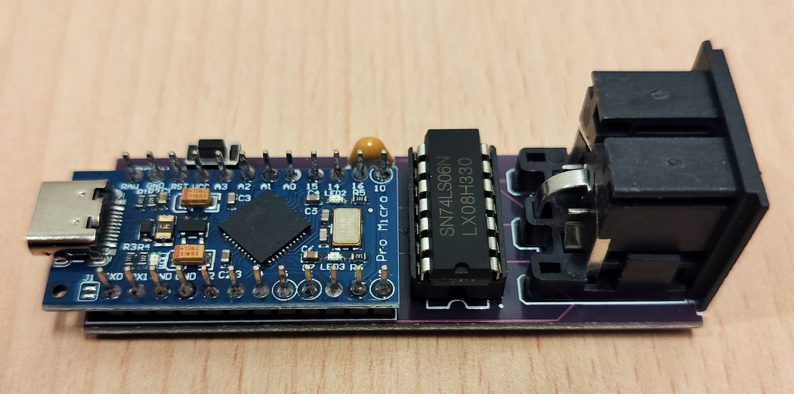

# xum1541-7406

## Overview
This is an implementation of the xum1541 module that is described in the [OpenCBM/xum1541](https://github.com/OpenCBM/OpenCBM/tree/master/xum1541) repository, allowing you to transfer data to/from a 1541/1571/1581 disk drive over USB.  This does not make your Commodore disk drive a USB device, but rather allows communication with it via the [OpenCBM](https://github.com/OpenCBM/OpenCBM) tools.  The module uses a 5V/16MHz Arduino Pro Micro (or compatible) board to run the firmware, and uses a 7406 logic circuit to allow for multiple connections on the IEC serial bus.

This repo contains the module schematics, bill of materials, and gerber files so that you can make your own hardware.

## Firmware and Tool Installation
To use the module, you must first flash the `xum1541-PROMICRO_7406-v08.hex` firmware (or later version) to the Pro Micro board, which may be done with the Arduino IDE, `avrdude`, or any suitable programmer.  The firmware is obtainable from the aforementioned [OpenCBM/xum1541](https://github.com/OpenCBM/OpenCBM/tree/master/xum1541) repository and the flashing instructions are thoroughly documented in Tebl's [C64-XUM1541-II repository documentation](https://github.com/tebl/C64-XUM1541-II/blob/main/documentation/firmware.md#11-flashing-avr).  For users familiar with the flashing process, press the `RESET` button on the XUM1541 module twice to put it in programming mode then quickly execute the programming command from your connected programmer.

[OpenCBM](https://github.com/OpenCBM/OpenCBM) is the defacto tool for communicating with any XUM1541 device.  A device driver is required for use with OpenCBM, which may be installed by following the instructions from the [OpenCBM documentation](https://opencbm.gitlab.io/opencbm/).  For Windows installations, the process is thoroughly documented in Tebl's [C64-XUM1541-II repository documentation](https://github.com/tebl/C64-XUM1541-II/blob/main/documentation/firmware.md); essentially, install the `libusb-win32` device driver followed by running the OpenCBM install script.

NOTE: the `xum1541-PROMICRO_7406-v08` firmware contains a startup bug when used with 1571 and 1581 devices.  Please refer to this [bug report](https://github.com/OpenCBM/OpenCBM/issues/111) for details including a work-around and beta firmware that addresses the issue.

---
Shield: [![CC BY-SA 4.0][cc-by-sa-shield]][cc-by-sa]

This work is licensed under a
[Creative Commons Attribution-ShareAlike 4.0 International License][cc-by-sa].

[![CC BY-SA 4.0][cc-by-sa-image]][cc-by-sa]

[cc-by-sa]: http://creativecommons.org/licenses/by-sa/4.0/
[cc-by-sa-image]: https://licensebuttons.net/l/by-sa/4.0/88x31.png
[cc-by-sa-shield]: https://img.shields.io/badge/License-CC%20BY--SA%204.0-lightgrey.svg
